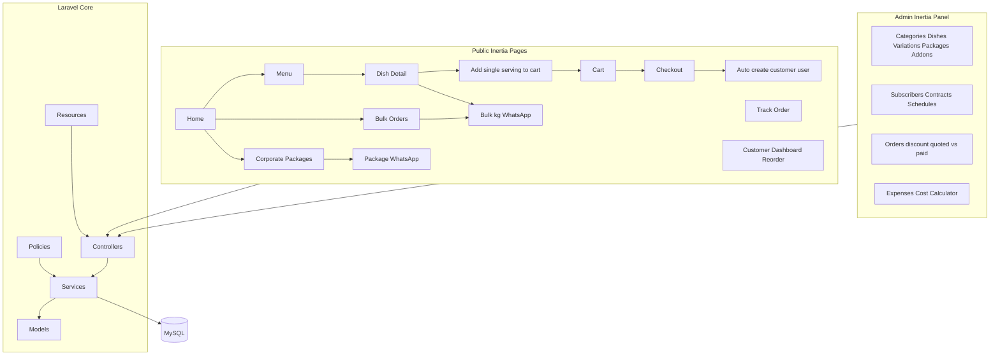

# Corporate Cravings — Fresh Laravel 13 + Inertia Build

Greenfield remake of [corporatecravings.pk](https://corporatecravings.pk/) as one Laravel app (Inertia + React). **No reference to, migration from, or reuse of any previous Corporate Cravings codebase.** Schema, services, seed data, and UI are designed only from the requirements in this conversation.

**Related notes:** [PHASE_0.md](./PHASE_0.md) · [PHASE_1.md](./PHASE_1.md) · [PHASE_1_5.md](./PHASE_1_5.md) · [PHASE_2.md](./PHASE_2.md) · [PHASE_3.md](./PHASE_3.md) · [PHASE_4.md](./PHASE_4.md) · [PHASE_5.md](./PHASE_5.md) · [PHASE_6.md](./PHASE_6.md) · [PHASE_7.md](./PHASE_7.md) · [PHASE_8.md](./PHASE_8.md) · [PHASE_9.md](./PHASE_9.md) · [PHASE_10.md](./PHASE_10.md) · [PHASE_11.md](./PHASE_11.md) · [PHASE_12.md](./PHASE_12.md) · [PHASE_13.md](./PHASE_13.md) · [PHASE_14.md](./PHASE_14.md) · [PHASE_15.md](./PHASE_15.md) · [PHASE_16.md](./PHASE_16.md) · [PHASE_17.md](./PHASE_17.md) · [PHASE_18.md](./PHASE_18.md) · [PHASE_19.md](./PHASE_19.md) · [PHASE_20.md](./PHASE_20.md) · [PHASE_21.md](./PHASE_21.md) · [PHASE_22.md](./PHASE_22.md) · [PHASE_23.md](./PHASE_23.md) · [PHASE_24.md](./PHASE_24.md) · [PHASE_25.md](./PHASE_25.md) · [PHASE_26.md](./PHASE_26.md) · [PHASE_27.md](./PHASE_27.md) · [PHASE_28.md](./PHASE_28.md) · [PHASE_29.md](./PHASE_29.md) · [PHASE_30.md](./PHASE_30.md) · [PHASE_31.md](./PHASE_31.md) · [PHASE_32.md](./PHASE_32.md) · [PHASE_33.md](./PHASE_33.md) · [PHASE_33_5.md](./PHASE_33_5.md) · [PHASE_34.md](./PHASE_34.md) · [PHASE_35.md](./PHASE_35.md) · [PHASE_36.md](./PHASE_36.md) · [PHASE_37.md](./PHASE_37.md) · [PHASE_38.md](./PHASE_38.md) · [PHASE_39.md](./PHASE_39.md)

## Status

| Phase | Scope | Status |
|-------|--------|--------|
| 0 | Bootstrap (Laravel, modules, ImageService, status/error, theme, security) | Completed |
| 1 | Fresh schema + seed | Completed |
| 1.5 | Stitch design prompt (light + dark, public + admin + portals) | Completed |
| 2 | Admin shell + Dashboard | Completed |
| 3 | Users & Roles CRUD | Completed |
| 4 | Global Statuses & Error Messages page | Completed |
| 5 | Categories CRUD | Completed |
| 6 | Products/Dishes CRUD | Completed |
| 7 | Dish Variations CRUD | Completed |
| 8 | Addons CRUD | Completed |
| 9 | Packages CRUD | Completed |
| 10 | Delivery Zones CRUD | Completed |
| 11 | Subscribers CRUD | Completed |
| 12 | Subscriber Contracts CRUD | Completed |
| 13 | Subscriber Schedule page | Completed |
| 14 | Monthly Schedule Cron | Completed |
| 15 | Unified Orders page | Completed |
| 16 | Manual Bulk/Event Orders CRUD | Completed |
| 17 | Expense Categories CRUD | Completed |
| 18 | Raw Materials CRUD | Skipped (see [PHASE_18.md](./PHASE_18.md)) |
| 19 | Expenses CRUD | Completed |
| 20 | Dish Cost Calculator | Completed |
| 21 | CMS Pages CRUD | Completed |
| 22 | Site Settings page | Completed |
| 23 | Reports pages | Completed |
| 24 | Public layout + Home page | Completed |
| 25 | Menu listing page | Completed |
| 26 | Dish detail page | Completed |
| 27 | Corporate Packages listing/detail | Completed |
| 28 | Bulk Orders listing | Completed |
| 29 | Cart page | Completed |
| 30 | COD Checkout page | Completed |
| 31 | Order Success + Tracking pages | Completed |
| 32 | Customer login/dashboard/history/reorder | Completed |
| 33 | Subscriber portal | Completed |
| 33.5 | Subscriber bill slips / receipts | Completed |
| 34 | About page | Completed |
| 35 | Contact page | Completed |
| 36 | FAQ page | Completed |
| 37 | Legal pages + 404 | Completed |
| 38 | Google Analytics + Consent | Completed |
| 39 | SEO, sitemap and structured data | Completed |
| Later | Mobile API (Sanctum) | Pending |

## Locked decisions

- **Stack:** Laravel 13 + Inertia v3 + React 19 + TypeScript + Tailwind + MySQL 8
- **Auth:** Laravel session auth (official React starter kit) — one app, no separate SPA API
- **Architecture:** Module folders + thin controllers + reusable Services + Form Requests + Policies + API Resources
- **Public site:** Menu (single servings) + **Packages** (corporate offers) + **Bulk orders** (same dishes, large kg quantities) + dish detail shows both single and bulk variations. **Cart/checkout (COD) for cartable single-serving variations only.** Both **corporate packages and bulk kg offerings order via WhatsApp** (staff enter deals in admin). Site still markets everything clearly
- **Catalog model:** every dish starts as one record (`title` unique, `slug` auto from title, short description, image); admin adds **variations** (quantity + price) — e.g. 1 serving, 5 kg, 8 kg, 10 kg
- **Packages:** corporate meal offers built from dishes. On create, system **averages included dish prices** (sum ÷ dish count) → `base_amount_per_person` → admin sets package `discount` → **`total_amount_per_person`** (final package price shown **publicly** on Packages page)
- **Subscriber contracts (private pricing):** when a company buys a package, contract stores `package_amount`, `discount`, `agreed_total` (contract amount). These three are **not public** — visible only to **admin** and that **subscriber** (both parties). Public site never shows a company's negotiated rate
- **Bulk / event:** same menu dishes at large quantities (kg tiers), not a separate dish catalog
- **Checkout identity:** collect customer base info → auto-create `customer` user if phone new; default password = phone number; login for dashboard, tracking, reorder
- **Order money (admin-only paid field):** orders keep list/discount/quoted as needed; `amount_paid` (what customer actually paid) is admin-only for profit evaluation. Bulk WhatsApp deals use list → discount → quoted like before
- **Addons:** sauces, drinks, and similar extras as a first-class catalog (`addons` + optional dish links); selectable on website cart/checkout and on admin bulk/corporate/event order entry; priced and stored on `order_item_addons`
- **Delivery zones:** admin CRUD for zones, each with its own delivery fee; checkout picks zone → applies that fee to COD total
- **Subscriber auto-scheduling:** creating/renewing a subscriber auto-generates the month's daily schedule + orders (grouped by week, one entry per contracted day). Admin can shuffle/edit any day anytime. A **monthly cron** rolls the next month using the same pattern as the previous month, so nothing is added manually — yet every day stays individually editable
- **Unified orders page:** one admin Orders screen lists **all** orders regardless of type/channel (individual, event, subscription, web/admin) so nothing is missed; filter by type, channel, status, date, subscriber
- **Catalog seed (data/media only):** copy **category names, dish names/descriptions, and image files** from `/var/www/corporate-craving-final` as seed content only. Remap into **our** schema (`title`, auto `slug`, `short_description`, `dish_variations` with single/bulk flags, etc.). **Do not reuse old Prisma schema, table shapes, enums, services, order flows, or DB push patterns**
- **Own DB design (10/10):** schema, indexes, FKs, soft deletes, money decimals, status codes, channel tracking, contract pricing privacy, and ImageService lifecycle are designed for this project only — fully optimized for Laravel + MySQL, not a port of the old Next/Prisma model
- **Image pipeline:** every upload is auto-compressed and converted to **WebP** (fallback JPG if needed) before writing to storage; no hard upload size reject — compress first, then store. On admin **update**, if a new image replaces an old one, **delete the old file**. On **delete** of category/dish/package/addon/user avatar/etc., **delete all linked images** so storage has no orphans
- **Delivery of work:** install → **full DB first** (with imported catalog seed) → Stitch design prompts → small CRUD phases one-by-one
- **Brand:** Corporate Cravings / corporatecravings.pk (Islamabad, PKR)
- **Analytics:** Google Analytics 4 through an environment-configured measurement ID, with consent-aware loading and key commerce/WhatsApp events
- **Public content:** complete business website with About, Contact, FAQ, Privacy Policy, Terms, delivery/cancellation/refund information, and required footer links
- **Theme:** light and dark modes for public site and admin (system preference + manual toggle; preference persisted)
- **Global statuses & errors:** one central registry for all domain statuses and user-facing error/success codes — no raw enum strings or typed exception text shown in UI
- **Channels / future mobile app:** schema and API-shaped resources ready for a later mobile app; every order stores `channel` (`web` | `mobile_app` | `admin`) and related client metadata; web remains fully mobile-responsive today
- **Fresh build:** no reuse of old app code, architecture, or DB flow; **exception only:** import category/dish **names + images** as seed assets, remapped to our optimized schema



## Phase 0 — Project bootstrap (first execution step)

In `/var/www/cravings-new`:

1. Create Laravel 13 app with official **React + Inertia** starter kit
2. Configure `.env` MySQL (`corporate_cravings`), app name, timezone `Asia/Karachi`, public URL, and analytics placeholders
3. Install essentials: Spatie Laravel Permission, Laravel Pint, Pest, Intervention Image (WebP/JPG compress), storage link for uploads
4. Folder conventions (module-wise):

```
app/Modules/{Catalog,Packages,Subscribers,Orders,Expenses,Users,Delivery,Addons}/
  Models/  Services/  Http/{Controllers,Requests,Resources}  Policies/
app/Support/  (ApiResponse, Money, StatusRegistry, ErrorCatalog, ImageService, enums)
resources/js/Pages/{Public,Admin,Subscriber,Customer}/
resources/js/Components/{Theme,StatusBadge,FlashToast}/
```

5. Standard response helpers for Inertia props + any JSON endpoints (`success`, `message`, `data`, `errors`, `meta`, `code`) — same shape later reused by mobile API
6. **Global status & error layer** (single source of truth):
   - PHP enums / `statuses` lookup config for order, schedule, payment, user, expense, etc.
   - Shared `StatusRegistry` maps code → label, color, badge variant (light/dark)
   - Shared `ErrorCatalog` maps machine codes → safe user messages (no stack traces, no raw type names)
   - One admin **Statuses & messages** settings page to review/edit display labels where needed
   - Frontend: one `StatusBadge` + one flash/toast system; never render raw status keys or exception class names
7. Theme baseline: Tailwind dark mode (`class`), theme provider, light/dark toggle, CSS variables for brand tokens
8. **Shared `ImageService`:** accept any upload → compress + convert to WebP (JPG fallback) → store under `storage/app/public/...`; on replace delete previous path; on model delete cascade-delete files; used by all catalog/media CRUDs
9. Security baseline: CSRF, auth + role middleware, Form Requests, Policies on every mutation, rate limiting on login/checkout, guarded mass assignment, MIME checks on uploads (still compress large files rather than hard-reject by size), no secrets in repo

## Phase 1 — Database first (designed from your requirements)

Cohesive migration set covering the business model you described — companies needing daily meals, event catering, packages, single website orders, expenses, and dish cost/profit calculator.

### Core tables

- **Auth / roles:** `users` + Spatie `roles` / `permissions` / pivots; profile fields (`name`, `phone` unique login identifier, email optional, address); phone used as default password on auto-signup
- **Catalog — dishes first:**
  - `categories` (name, image, status)
  - `dishes`: `title` (unique), `slug` (auto from title, unique), `short_description`, image(s), category, status
  - `dish_variations`: quantity label + numeric amount + unit (`serving` | `kg` | `persons`), `price`, sort order, flags:
    - `is_single` / cartable for website menu checkout (typically 1 serving)
    - `is_bulk` for Bulk Orders page + dish-detail bulk block (e.g. 5 kg, 8 kg, 10 kg)
  - One dish (e.g. Pulao) owns all size/price rows — no duplicate dish records for bulk
- **Addons:** `addons` (title, slug, short description, price, image, type e.g. sauce/drink/extra, status) + optional `dish_addon` pivot (which addons can pair with which dishes; empty = available generally). Used on single cart orders and on admin bulk/corporate/event entry
- **Packages (corporate offers):** `packages`, `package_items`
  - Admin picks dishes (using each dish's single/per-person variation price)
  - System computes `base_amount_per_person` = average of selected dish prices (sum ÷ count)
  - Admin sets `discount_amount` and/or `discount_percent`
  - System stores `total_amount_per_person` = base − discount (**this is the public package price**)
  - Public Packages page shows only `total_amount_per_person` (+ name, dishes, description) — not internal contract deals
- **Delivery zones:** `delivery_zones` (name, fee, active, sort) — full admin CRUD; checkout applies the selected zone's fee
- **Subscribers (contracts):** `subscribe_contracts` linked to `users` (subscriber role) — **no duplicated company/contact/phone/email/address** (those live on `users` only). Private `package_amount`, `discount`, `agreed_total`. Plus `subscriber_package_history`, `subscriber_schedules`
- **Orders:** `orders`, `order_items`, `order_item_addons`, `order_status_histories`
  - Types: `individual` | `event` | `subscription` (bulk WhatsApp deals as `event` or admin individual with bulk line items)
  - **`channel`:** `web` | `mobile_app` | `admin`
  - Payment method: COD for web checkout
  - **Pricing on orders (bulk/event/admin deals):** `list_amount`, `discount_amount`/`discount_percent`, `quoted_amount`, `amount_paid` (admin-only)
  - Subscription day orders derive from schedule using contract `agreed_total` × persons
  - Line items snapshot dish/variation/addon prices
  - Optional: `client_platform`, `app_version`, `user_agent`
- **Finance:** `expense_categories`, `expenses` (grocery unit prices feed the cost calculator; no separate raw-materials / recipe tables)
- **Ops / CMS:** `settings`, editable `pages`, media via Laravel `storage`
- **Auth readiness for mobile later:** Sanctum tokens without rewriting core tables

### Order statuses (global registry)

Codes (labels editable from statuses admin page):

`pending` → `confirmed` → `leave_for_delivery` → `delivered` → `completed` · plus `cancelled` (and any other ops statuses added later)

UI always uses StatusRegistry badges — never raw codes.

## Roles & permissions (locked)

| Role | Key abilities | Cannot |
|------|---------------|--------|
| **super_admin** | Full admin panel, all widgets (orders, earnings, corporate contracts, …), create **admin** users, P&L | — |
| **admin** | Same ops + earnings/P&L, create managers/assistants/subscribers/customers | Create **admin** users |
| **manager** | Same ops as admin for catalog/orders/contracts | Create **managers**; see **earnings / P&L** |
| **assistant** | Update order status, add expenses, limited ops | Create **assistants**; see **payment** pages / earnings |
| **subscriber** | Portal: delivered orders, total bill, persons served; schedules, history, contract | Admin panel |
| **customer** | Portal: order count, track order, history | Admin panel |

Permissions live in [`config/permissions.php`](../config/permissions.php), seeded via Spatie, enforced with `$user->can(...)` / `RoleAccess`.

### Business rules in schema

- **Dish → variations:** admin creates dish once; adds multiple quantity/price rows. Menu lists single/cartable variations; Bulk page + dish detail list `is_bulk` variations of the same dishes
- **Package pricing (public catalog):**
  1. Add dishes → system averages dish prices (sum ÷ count) → `base_amount_per_person`
  2. Apply package `discount` → `total_amount_per_person`
  3. **Only `total_amount_per_person` is shown publicly** as the package price
- **Contract pricing (private — admin + that subscriber only):**
  1. Company buys a package → start from package public total as `package_amount`
  2. Negotiate contract `discount`
  3. Store `agreed_total` (final contract amount/rate)
  4. Never render these three fields on public Marketing/Packages pages
- **Bulk / event:** same dishes, large kg variations; browse on site; order via WhatsApp; admin enters order with list → discount → quoted; `amount_paid` later
- **Addons:** sauces, drinks, extras on web cart and admin bulk/corporate entry
- **Website checkout (COD):** cartable single variations + optional addons; auto-create user by phone (password = phone); `channel=web`, status `pending`
- **Subscriber schedule:** daily totals use contract `agreed_total` × persons that day; monthly cron rollover; editable per day
- **Order channel / delivery fee / statuses:** as before
- Money `DECIMAL(12,2)` PKR; snapshots on history + schedule; API-friendly schema

### Seeders (data only from old folder — our schema)

1. Copy category/dish **image files** and **names/descriptions** from `/var/www/corporate-craving-final`
2. Run images through our `ImageService` into `storage/app/public/...`
3. Insert into **our** tables only (`categories`, `dishes`, `dish_variations`, …) — never mirror old Product/ProductVariation/cuid/JSON-blob patterns
4. Variations use our flags: `is_single` / `is_cartable` / `is_bulk` / `on_listing`
5. Also seed demo users, addons, one package (base→discount→public total), one subscriber with private contract pricing + schedule week, delivery zones, expense categories, CMS pages

**Exit criteria:** `php artisan migrate --seed` succeeds on our schema; images are compressed WebP in storage; no dependency on old DB.

## Phase 1.5 — Stitch design prompts (after DB is locked)

**Status:** single prompt ready for review — `docs/PHASE_1_5.md`  
**Exit:** approve light+dark screen set before Phase 2.

One Stitch prompt mapped to the new schema fields:

1. Public home + nav: Home, About, **Menu**, **Packages** (shows public package total only), **Bulk Orders**, Cart, Track order, Contact, Login
2. Public detail: Category, Dish detail (single Add to cart + **addons** + **Bulk offerings** block with kg prices + WhatsApp), Package detail (public total + WhatsApp — no contract rates), Bulk listing page
3. Commerce: Cart (dishes + addons), Checkout (COD + zone fee + auto user), Order success, Track order, Customer dashboard (history + reorder)
4. Public support/legal: FAQ, Privacy, Terms, Delivery, Cancellation & Refund, 404
5. Shared footer: address, phone, email, hours, social, WhatsApp, legal links
6. Admin shell + CRUDs: Categories, Dishes (+ variations), Addons, Packages (base → discount → public total), Subscribers (private package_amount / discount / agreed_total), Schedules, unified Orders, Delivery zones, Expenses, Cost calculator, Users, pages, settings, statuses
7. Portals: Subscriber (schedule + **own** contract pricing); Customer dashboard

Design direction: brand-forward public site; Menu / Packages / Bulk as three clear paths; light + dark; mobile-first; shared status/error components only.

**Exit criteria:** approved screen set (light + dark) ready to implement page-by-page.

## Phase 2+ — One CRUD/page per phase

No combined CRUD implementation phases. Complete, test, review, and approve each phase before starting the next. Every CRUD phase includes its model/service, Form Requests, Policy/permissions, controller, routes, Inertia list/create/edit/view pages, reusable components, factory/seeder updates, and Pest feature tests.

### Admin phases

1. **Phase 2 — Admin shell + Dashboard page**
   - Responsive light/dark shell, role-aware navigation and shared UI components
   - KPIs for orders, subscriber deliveries, paid revenue, expenses and pending actions
2. **Phase 3 — Users & Roles CRUD**
3. **Phase 4 — Global Statuses & Error Messages page**
4. **Phase 5 — Categories CRUD**
   - Full image compression/replacement/deletion lifecycle
5. **Phase 6 — Products/Dishes CRUD**
   - Unique title, auto slug, short description, images and category
6. **Phase 7 — Dish Variations CRUD**
   - Quantity, unit, price, cartable/single and bulk flags
7. **Phase 8 — Addons CRUD**
   - Sauces, drinks and extras; global or linked to dishes
8. **Phase 9 — Packages CRUD**
   - Dishes → base/person → discount → public total/person
9. **Phase 10 — Delivery Zones CRUD**
10. **Phase 11 — Subscribers CRUD**
11. **Phase 12 — Subscriber Contracts CRUD**
   - Private package amount, discount and agreed total
12. **Phase 13 — Subscriber Schedule page**
   - Monthly/weekly/day view; generate, shuffle, edit and deliver
13. **Phase 14 — Monthly Schedule Cron**
   - Idempotent rollover with duplicate prevention
14. **Phase 15 — Unified Orders page**
   - Every order type/channel, filters, details and status timeline
15. **Phase 16 — Manual Bulk/Event Orders CRUD**
   - Variations/addons and list → discount → quoted → paid
16. **Phase 17 — Expense Categories CRUD**
17. **Phase 18 — Raw Materials CRUD** — **skipped** (removed in Phase 1; see [PHASE_18.md](./PHASE_18.md))
18. **Phase 19 — Expenses CRUD**
19. **Phase 20 — Dish Recipes / Cost Calculator** — calculator only (stateless; no recipe DB)
20. **Phase 21 — CMS Pages CRUD**
21. **Phase 22 — Site Settings page**
22. **Phase 23 — Reports pages**

### Public website phases

23. **Phase 24 — Public layout + Home page**
24. **Phase 25 — Menu listing page**
25. **Phase 26 — Dish detail page**
26. **Phase 27 — Corporate Packages listing/detail**
27. **Phase 28 — Bulk Orders listing**
28. **Phase 29 — Cart page**
29. **Phase 30 — COD Checkout page**
30. **Phase 31 — Order Success + Tracking pages**
31. **Phase 32 — Customer login/dashboard/history/reorder**
32. **Phase 33 — Subscriber portal**
33. **Phase 33.5 — Subscriber bill slips / receipts**
34. **Phase 34 — About page**
35. **Phase 35 — Contact page**
36. **Phase 36 — FAQ page**
37. **Phase 37 — Legal pages + 404**
38. **Phase 38 — Google Analytics + Consent**
39. **Phase 39 — SEO, sitemap and structured data**
40. **Later separate phase — Mobile API (Sanctum)**

### Completion gate for every phase

- Change only the named CRUD/page; do not start the next phase
- Verify light/dark and mobile/desktop layouts
- Cover authorization, validation, statuses/errors, audit behavior and image lifecycle where applicable
- Pass Pest tests and lint/format checks
- Stop for user review before proceeding

## Engineering standards (every phase)

- Services own business logic; controllers stay thin
- Spatie permissions + Policies on every action
- Form Requests on all writes; Resources for response shape
- DB transactions for schedule→order, billing snapshots, multi-row creates
- Pest: happy path + forbidden role
- Pint; eager loads (no N+1); soft deletes where audit matters
- Analytics scripts load only after consent where applicable; never expose phone numbers, addresses, names, or order details to analytics
- Public and admin UI: light + dark, mobile-first responsive (touch targets, readable forms on small screens), accessibility, performance, crawlability, metadata
- No raw status codes, enum names, or exception types in user-facing UI — StatusRegistry + ErrorCatalog only
- Resources/JSON payloads stay API-friendly so a future mobile app can consume the same domain without schema rewrites
- All media goes through `ImageService` (compress → WebP/JPG); update replaces + deletes old file; model delete removes linked files — no orphan storage files

## Immediate next step

**Public website phases are complete (0–39; Phase 18 skipped). Next when needed: Mobile API (Sanctum).**
